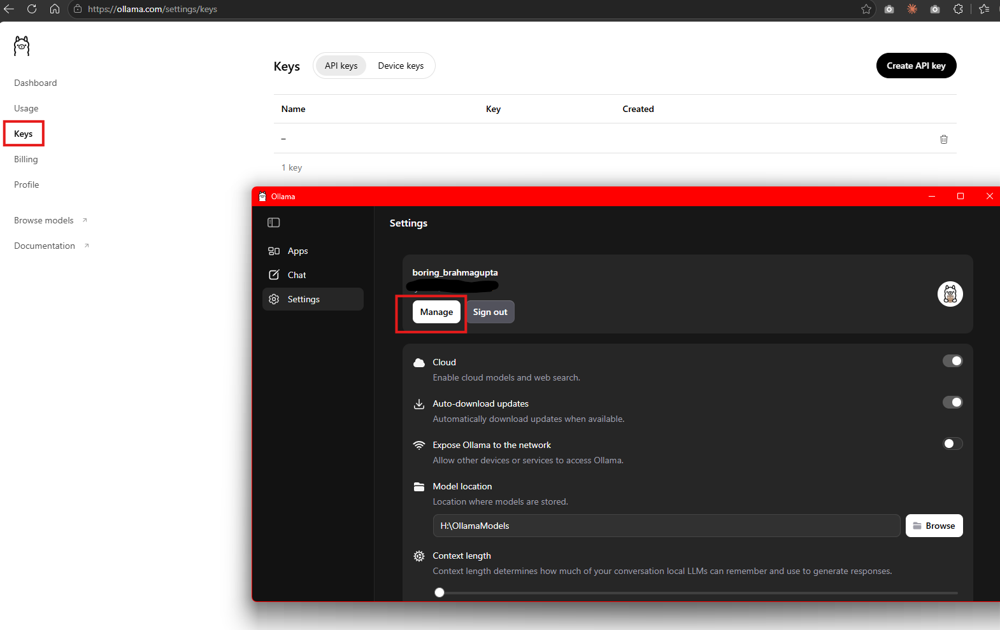
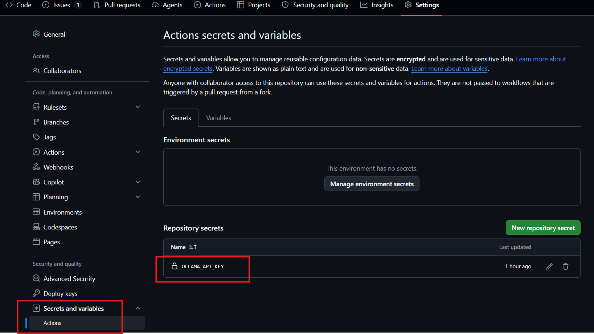
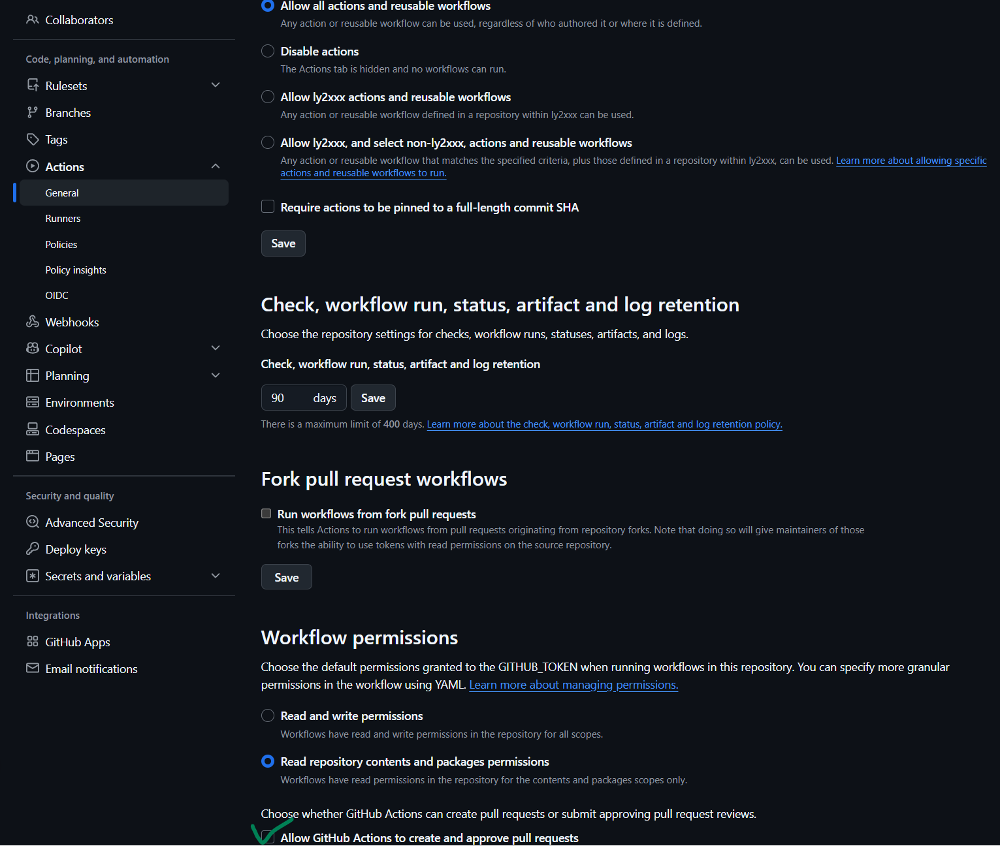

# SDLC GitHub

Automated software development with AI through GitHub Actions.

A Claude plugin with one skill, `sdlc-github`, that takes a feature from a one-line idea to a
reviewed pull request through the [SDLC Pipeline](https://github.com/ly2xxx/.github) on
GitHub Actions. Ollama writes the intent, spec and plan; Claude builds the approved plan one
phase at a time, each phase on its own branch and pull request; deterministic checks decide
whether each phase, and the whole feature, is done. Claude never marks its own work as passed.

[ly2xxx.github.io/sdlc-github/sdlc-models.html](https://ly2xxx.github.io/sdlc-github/sdlc-models.html)

## Install

This repository is its own marketplace, `ly2xxx`.

- **claude.ai, the desktop app and Cowork:** Customize > Plugins > Add > Add marketplace, enter
  `ly2xxx/sdlc-github`, then add **SDLC GitHub**. It also reaches your Claude Code sessions.
- **Claude Code:**

  ```bash
  claude plugin marketplace add ly2xxx/sdlc-github
  claude plugin install sdlc-github@ly2xxx
  ```

## Use

In a session on a repository, say what to build:

> use sdlc-github to build a version endpoint on the FastAPI app

or join a feature that is already under way: "build feature 003", "re-verify feature 003".

On a new repository the skill sets the pipeline up first: it adds the two caller workflows,
[`sdlc.yml` and `sdlc-phase.yml`](plugins/sdlc-github/skills/sdlc-github/templates), and the
`sdlc` label, and fits them to the repository: its test command and toolchain, and how you
approve the design (step 3 below). Then it asks you for the settings below, which only you can
change.

## Set up your repository

### 1. Add your Ollama API key (required)

The pipeline writes the intent, spec and plan with Ollama Cloud, using your own key.

1. Sign in at [ollama.com/settings/keys](https://ollama.com/settings/keys) and select
   **Create API key**. **Settings > Manage** in the Ollama desktop app takes you there too.
2. In your GitHub repository, open **Settings > Secrets and variables > Actions** and select
   **New repository secret**.
3. Name it `OLLAMA_API_KEY`, paste the key and select **Add secret**.





### 2. Let the pipeline open its pull request (recommended)

1. Open **Settings > Actions > General** and scroll down to **Workflow permissions**.
2. Tick **Allow GitHub Actions to create and approve pull requests** and select **Save**.

Leave the permissions choice above it as it is; the pipeline's workflows ask for the access
they need. Without this setting the run still finishes, but its last step can't open the pull
request: it prints the title and body, and Claude opens it for you.



### 3. Choose how you approve the design

You approve the intent, the spec and the plan before anything is built.

- **Public repository:** add required reviewers to the `sdlc-review` environment, and the run
  pauses for your approval at each review step; the [pipeline guide](https://github.com/ly2xxx/.github/blob/main/.github/workflows/README.md#setup-once-in-the-calling-repository)
  shows how.
- **Private repository:** environments there can't have required reviewers below GitHub
  Enterprise, so the skill sets `review-gate: stop`. Each run writes one document and ends;
  Claude shows it to you, and starts the next run only when you say to carry on.

## What it runs

The skill is instructions only: no hooks, MCP servers or bundled programs. Following them,
Claude:

- clones `ly2xxx/.github` at the version your workflows call, and runs its `sdlc_stage.py verify` on your machine, along with each phase's Verify commands from the approved plan and
  your test suite;
- in a new repository, commits the two caller workflows and creates the `sdlc` label;
- pushes `phase/<feature>/<n>` branches, opens and merges pull requests into
  `feature/<feature>`, and opens `sdlc` issues to start pipeline runs;
- reads workflow runs and their logs.

It sends nothing anywhere else. The pipeline itself calls Ollama Cloud from GitHub Actions with
your repository's key.

## License

[PolyForm Noncommercial 1.0.0](LICENSE): free for personal and noncommercial use. Business use
needs a commercial license; see [LICENSING.md](LICENSING.md).
