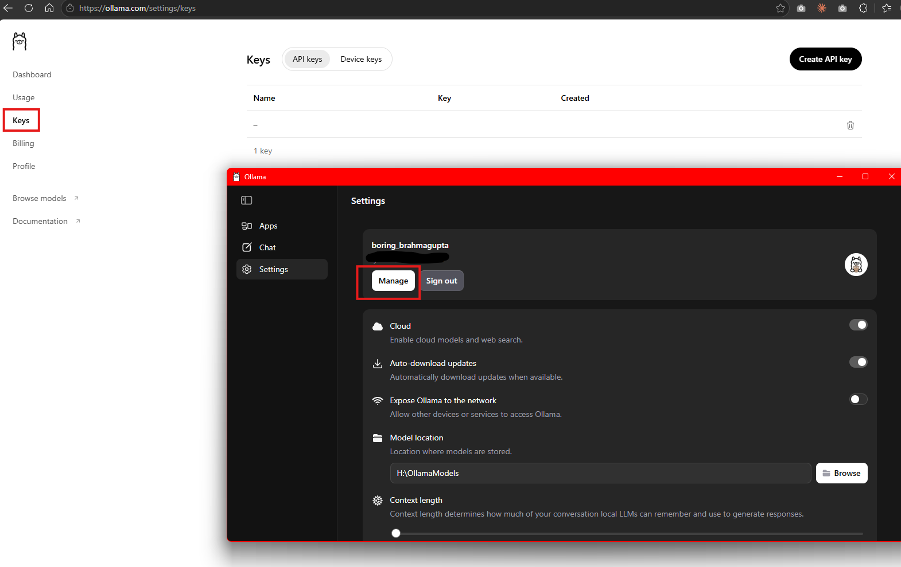
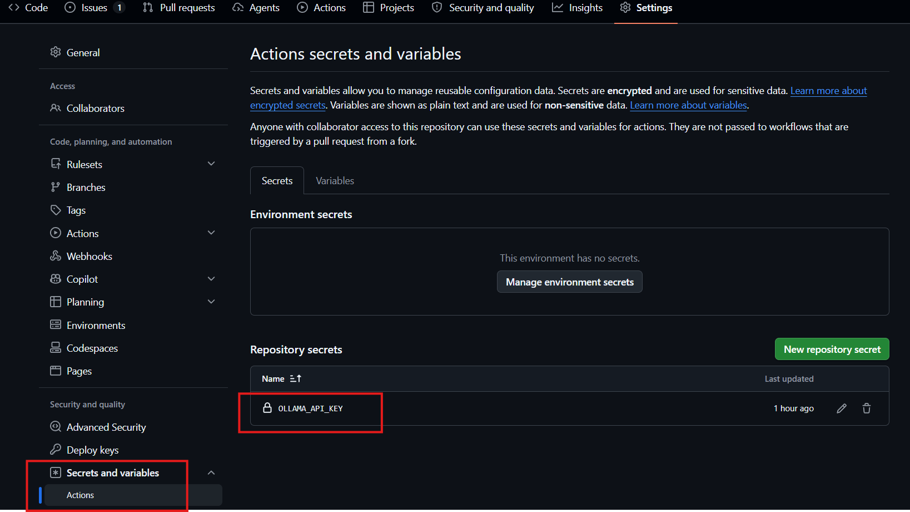
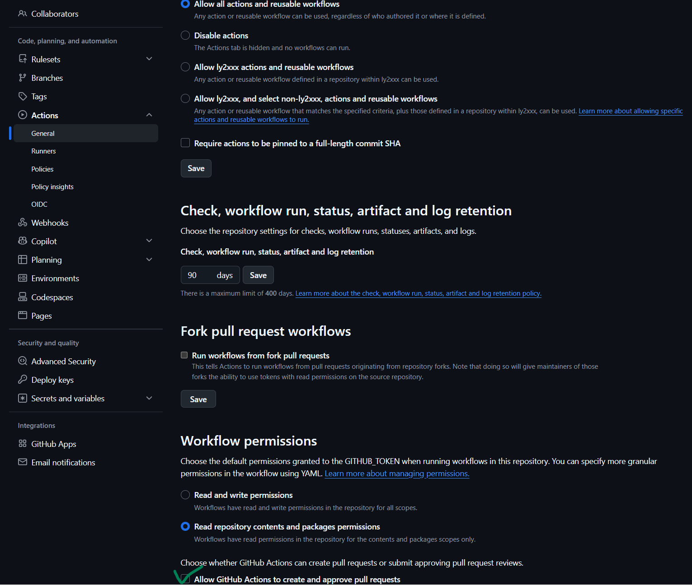

# SDLC GitHub

Automated software development with AI through GitHub Actions.

A Claude plugin with three skills. `sdlc-github-setup` makes a repository ready for the
pipeline, `sdlc-github` takes a feature from a one-line idea to a reviewed pull request
through the [SDLC Pipeline](https://github.com/ly2xxx/.github) on GitHub Actions, and
`sdlc-github-epic` breaks a feature too big for one run into pieces and builds them in order. Ollama writes the intent, spec and plan; Claude builds the approved plan one
phase at a time, each phase on its own branch and pull request; deterministic checks decide
whether each phase, and the whole feature, is done. Claude never marks its own work as passed.

[ly2xxx.github.io/sdlc-github/sdlc-models.html](https://ly2xxx.github.io/sdlc-github/sdlc-models.html)

## Install

This repository is its own marketplace, `ly2xxx`.

- **claude.ai, the desktop app and Cowork:** Customize > Plugins > Add > Add marketplace, enter
  `ly2xxx/sdlc-github`, then add **SDLC GitHub**. It also reaches your Claude Code sessions.
- **Claude Code:**

  ```bash
  claude plugin marketplace add ly2xxx/sdlc-github
  claude plugin install sdlc-github@ly2xxx
  ```

## Use

In a session on a repository, say what to build:

> use sdlc-github to build a version endpoint on the FastAPI app

or join a feature that is already under way: "build feature 003", "re-verify feature 003".

### A large feature

One pipeline run plans at most four phases. For anything bigger, give the requirement, or a
file that holds it, to the epic skill:

> use sdlc-github-epic to build the team tasks feature in docs/requirements.md

1. Claude reads the requirement and the code, asks you about the open decisions, and writes a
   design document, `docs/<epic>.md`, with shared rules, facts from the code, and a section for
   each piece.
2. **You review and merge the design.** Every later run follows it word for word.
3. Claude builds one piece at a time through `sdlc-github`. Each run's issue points at its
   sections of the document (`design: docs/<epic>.md#piece-2`). **You merge each piece's pull
   request** before the next piece starts.
4. After each merge Claude records what was built in the document and in
   `sdlc/epics/<NNN>-<epic>.md`, so a later session can carry on from where this one stopped.
5. At the end you get a checklist of what the checks couldn't cover, such as schema changes
   to apply.

You can also point a single run at a design section yourself: put a
`design: docs/<file>.md#<heading>` line in the `sdlc` issue's body, or in the **design** box
of Run workflow.

## Set up your repository

In a session on the repository, say:

> set up sdlc-github in this repo

The `sdlc-github-setup` skill checks what the repository already has and adds what is
missing. It pushes the two caller workflows,
[`sdlc.yml` and `sdlc-phase.yml`](plugins/sdlc-github/skills/sdlc-github/templates), to the
default branch and creates the `sdlc` label. It then walks you through step 1 below, which
only you can do. Where Claude has the `gh` CLI and admin access to the repository, it offers
to do step 2 for you. Run it again at any time to check the setup. Asking `sdlc-github` to
build on a repository that isn't set up runs it first.

To add only the setup skill to a project, without the plugin:

```bash
npx skills add ly2xxx/sdlc-github --skill sdlc-github-setup
```

### 1. Add your Ollama API key (required)

The pipeline writes the intent, spec and plan with Ollama Cloud, using your own key.

1. Sign in at [ollama.com/settings/keys](https://ollama.com/settings/keys) and select
   **Create API key**. **Settings > Manage** in the Ollama desktop app takes you there too.
2. In your GitHub repository, open **Settings > Secrets and variables > Actions** and select
   **New repository secret**.
3. Name it `OLLAMA_API_KEY`, paste the key and select **Add secret**.





### 2. Let the pipeline open its pull request (recommended)

1. Open **Settings > Actions > General** and scroll down to **Workflow permissions**.
2. Tick **Allow GitHub Actions to create and approve pull requests** and select **Save**.

Leave the permissions choice above it as it is; the pipeline's workflows ask for the access
they need. Without this setting the run still finishes, but its last step can't open the pull
request: it prints the title and body, and Claude opens it for you.



Optional: required reviewers on the `sdlc-review` environment pause the run for your approval
at each review step; the [pipeline guide](https://github.com/ly2xxx/.github/blob/main/.github/workflows/README.md#setup-once-in-the-calling-repository)
shows how.

## What it runs

The skills are instructions only: no hooks, MCP servers or bundled programs. Following them,
Claude:

- clones `ly2xxx/.github` at the version your workflows call, and runs its `sdlc_stage.py verify` on your machine, along with each phase's Verify commands from the approved plan and
  your test suite;
- in a new repository, pushes the two caller workflows to the default branch, creates the
  `sdlc` label and, if you accept, turns on the two optional settings;
- pushes `phase/<feature>/<n>` branches, opens and merges pull requests into
  `feature/<feature>`, and opens `sdlc` issues to start pipeline runs;
- for an epic, opens pull requests for the design document and its status file, and
  updates them after each piece;
- reads workflow runs and their logs.

It sends nothing anywhere else. The pipeline itself calls Ollama Cloud from GitHub Actions with
your repository's key.

## License

[PolyForm Noncommercial 1.0.0](LICENSE): free for personal and noncommercial use. Business use
needs a commercial license; see [LICENSING.md](LICENSING.md).
